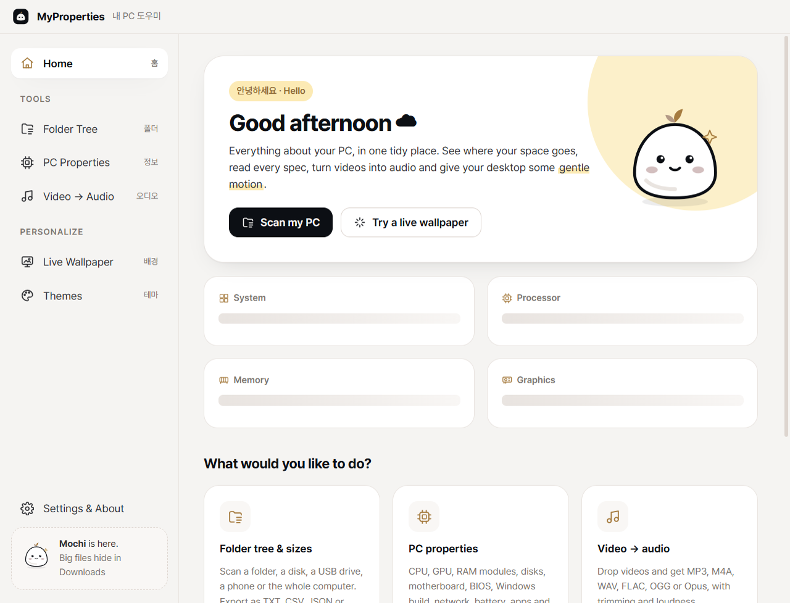
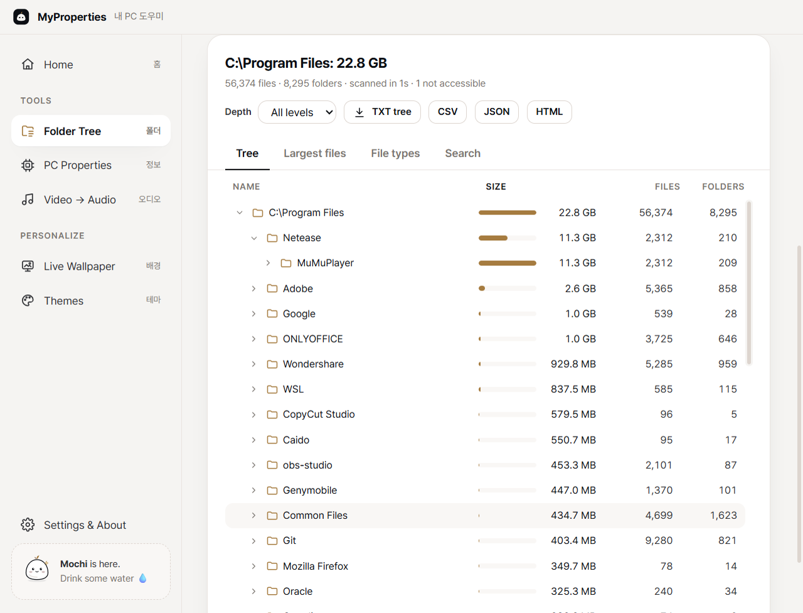
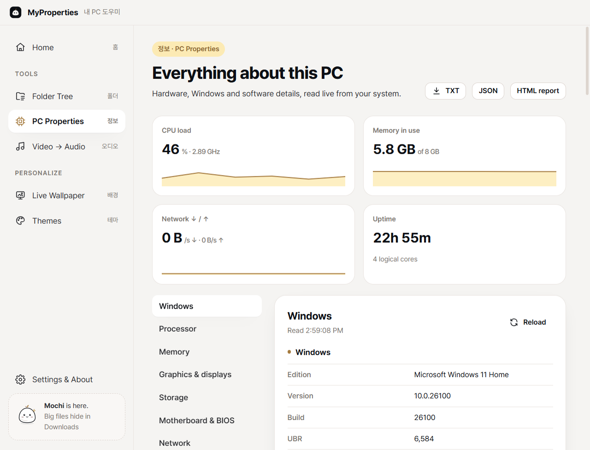
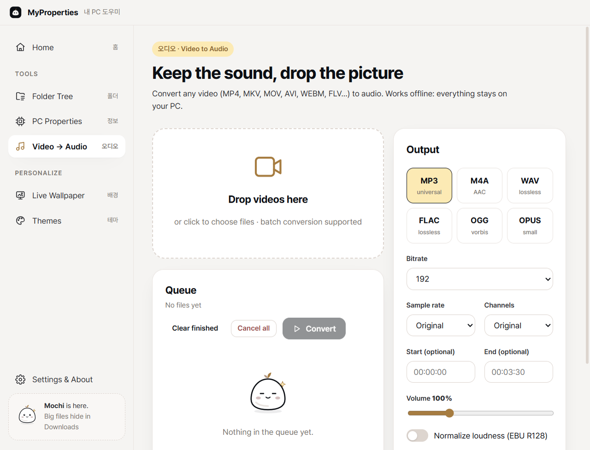
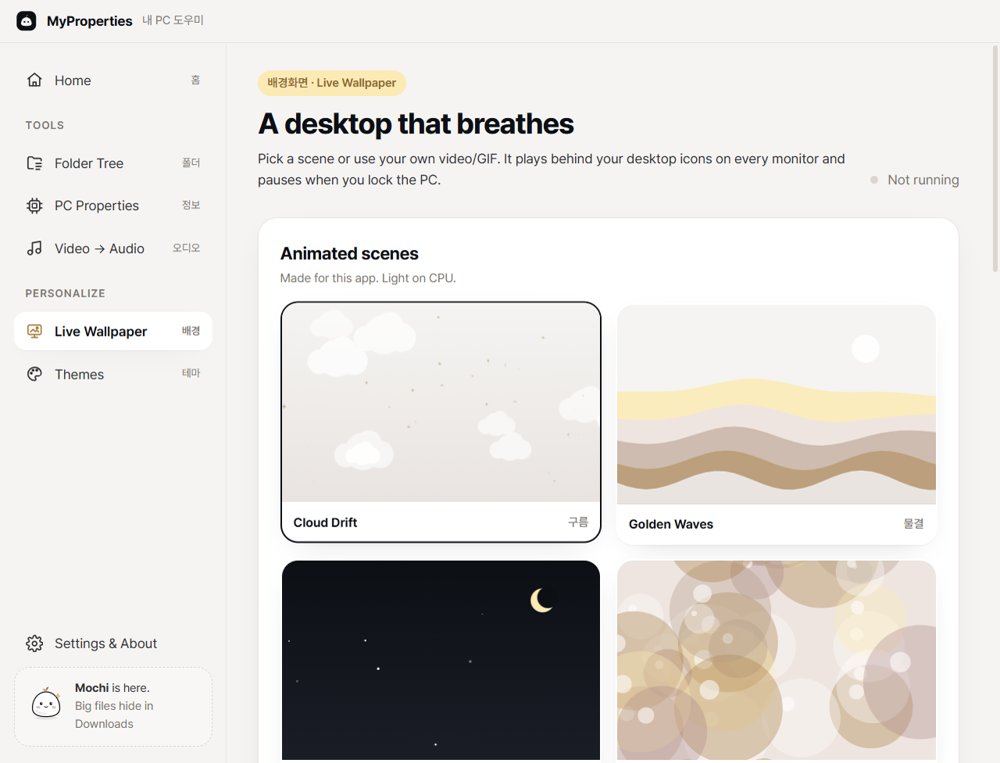

<div align="center">


# MyProperties

**A calm little toolkit for Windows. 내 PC 도우미**

Folder tree with sizes · Every PC property · Video → audio · Live wallpapers · Themes

[**Download**](../../releases/latest) · [Landing page](https://qub-official.github.io/myproperties/) · [Report a bug](../../issues)




</div>

---

## ✨ Features

### 📁 Folder tree & sizes (폴더)
- Scan the **entire computer**, a **single disk**, an **external / USB drive**, a **network drive**, a **phone or camera** (MTP) or **any folder**.
- Live, expandable tree sorted by size, name, file count or date. Each row shows a size bar.
- **Largest files**, **file types** breakdown and **search** by name.
- Export as a **TXT tree** (`├──` style), **CSV**, **JSON** or a self-contained **HTML** page, with an optional depth limit.
- Fast: uses the Win32 `FindFirstFileEx` API in a background thread (about 56,000 files in under 2 seconds on a 2014 desktop).

### 🖥️ PC properties (정보)
- Windows edition, version (e.g. 24H2), build + UBR, install date, last boot, Secure Boot, firmware, VBS, hotfixes.
- CPU (cores, threads, cache, flags, live per-core load), RAM modules, GPUs & displays, physical disks, volumes, partitions.
- Motherboard, BIOS, chassis, network adapters, Wi-Fi, battery health, audio, USB, Bluetooth, printers.
- Installed programs (filterable) and startup apps.
- Live gauges for CPU, memory and network. Export a full report as **TXT / JSON / HTML**.

### 🎵 Video → audio (오디오)
- Drag & drop any number of videos: MP4, MKV, MOV, AVI, WEBM, FLV, WMV, TS…
- Output **MP3, M4A (AAC), WAV, FLAC, OGG (Vorbis), Opus**.
- Bitrate, sample rate, mono/stereo, **trim start/end**, volume boost and **EBU R128 loudness normalization**.
- FFmpeg is bundled, so nothing else to install.

### 🌙 Live wallpaper (배경)
- Six hand-made animated scenes: *Cloud Drift, Golden Waves, Ink Night, Mochi Bubbles, Soft Rain, Mochi Friends*.
- Or use your own **video** (MP4/WEBM/MOV) or **GIF / image**.
- Runs **behind the desktop icons** on every monitor (Windows 10 and the new Windows 11 24H2+ desktop).
- Fill / fit / stretch / center, speed, dim, optional minimal clock (with the Korean weekday 화요일).
- Pauses when the PC is locked or (optionally) on battery. Keeps running from the tray and can start with Windows.

### 🎨 Themes (테마)
- App themes: **Paper, Cream, Sand, Nude, Ink** (dark).
- Windows: light/dark mode for apps and system, **accent colour** (Start, taskbar, title bars), transparency effects.
- Set a static wallpaper (fill, fit, stretch, tile, center, span) or apply any installed `.theme` pack.

| Folder tree | PC properties |
|---|---|
|  |  |
| **Video → audio** | **Live wallpaper** |
|  |  |

---

## 📦 Download

Go to [**Releases**](../../releases/latest) and pick:

- `MyProperties-Setup-x.y.z.exe`: installer (Start menu, desktop shortcut, uninstaller)
- `MyProperties-Portable-x.y.z.exe`: single file, no install

> **Windows SmartScreen** may say *"Windows protected your PC"* because the app isn't code-signed.
> Click **More info → Run anyway**.

---

## 🛠️ Build from source

Requirements: **Windows 10/11**, **Node.js 18+** (22 recommended).

```bash
git clone https://github.com/qub-official/myproperties.git
cd myproperties
npm install        # also downloads Electron and the FFmpeg binary
npm start          # run in development
npm run dist       # build installer + portable into ./dist
npm run icon       # (optional) re-render build/icon.png from build/icon.svg
```

Capture fresh screenshots of every page (used in this README):

```powershell
$env:MP_CAPTURE="docs\assets\screens"; npm start
```

### Project structure

```
myproperties/
├── src/
│   ├── main/                 # Electron main process
│   │   ├── main.js           # window, tray, IPC
│   │   ├── scanner-worker.js # folder tree scanner (worker thread, Win32 FindFirstFileEx)
│   │   ├── drives.js         # disks, USB drives, phones/cameras
│   │   ├── sysinfo.js        # PC & Windows properties
│   │   ├── converter.js      # FFmpeg video → audio queue
│   │   ├── wallpaper.js      # live wallpaper engine (WorkerW / Progman docking)
│   │   ├── themes.js         # Windows mode, accent, wallpaper, .theme files
│   │   ├── win32.js          # user32 bindings via koffi
│   │   ├── ps.js             # PowerShell / registry helpers
│   │   └── settings.js       # JSON settings in %APPDATA%
│   ├── renderer/             # the app UI (HTML/CSS/vanilla JS)
│   ├── wallpaper/            # wallpaper window + animated scenes
│   └── preload.js            # safe bridge between UI and main
├── build/                    # app icon
├── docs/                     # landing page (GitHub Pages)
├── scripts/make-icon.js
└── .github/workflows/        # release build + pages deploy
```

---

## 🚀 Publishing on GitHub (step by step)

1. Create a new repository named **`myproperties`** on GitHub.
2. Upload **everything in this folder except `node_modules/` and `dist/`** (drag & drop works; the `.gitignore` already excludes them if you use git).
3. **Replace `YOUR-USERNAME`** with your GitHub username in `README.md`, `package.json` and `docs/script.js` (the landing page also detects it automatically on `github.io`).
4. **Landing page:** *Settings → Pages → Build and deployment → Source: GitHub Actions*. The `pages.yml` workflow publishes `/docs`.
   *(Or choose "Deploy from a branch" → `main` → `/docs`.)*
5. **Release:** *Releases → Draft a new release*, create tag `v1.0.0` and attach the two `.exe` files from `dist/`.
   *Or* push a tag (`git tag v1.0.0 && git push --tags`) and the `release.yml` workflow builds and publishes them for you.

---

## 🔒 Privacy

MyProperties works entirely offline. No accounts, analytics or telemetry. The only network request is on the landing page, to show the latest release on the download buttons.

## 🎨 Palette

| Paper | Cream | Sand | Nude | Ink | Caramel | Mauve | Butter | Taupe | Charcoal |
|---|---|---|---|---|---|---|---|---|---|
| `#FFFFFF` | `#F5F4F2` | `#E9E4E0` | `#EEE5E0` | `#0C0F14` | `#A87C3A` | `#B08A8A` | `#FDEBB0` | `#B49A85` | `#2E2F33` |

## 📄 License

[MIT](LICENSE). Bundles FFmpeg (GPL build via `ffmpeg-static`), systeminformation (MIT), koffi (MIT) and the Pretendard font (OFL-1.1).
